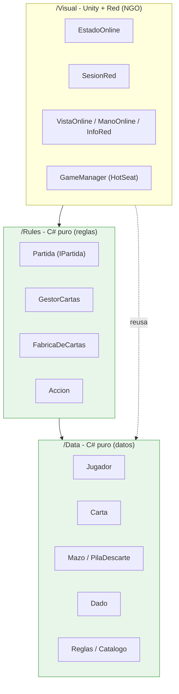
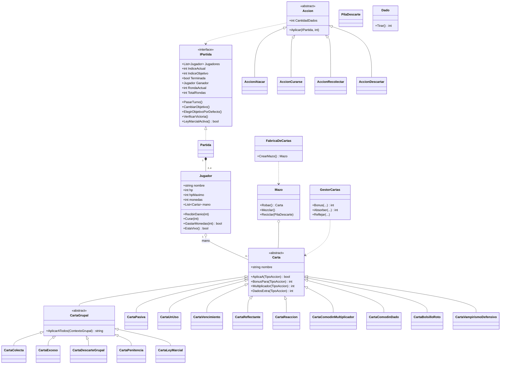
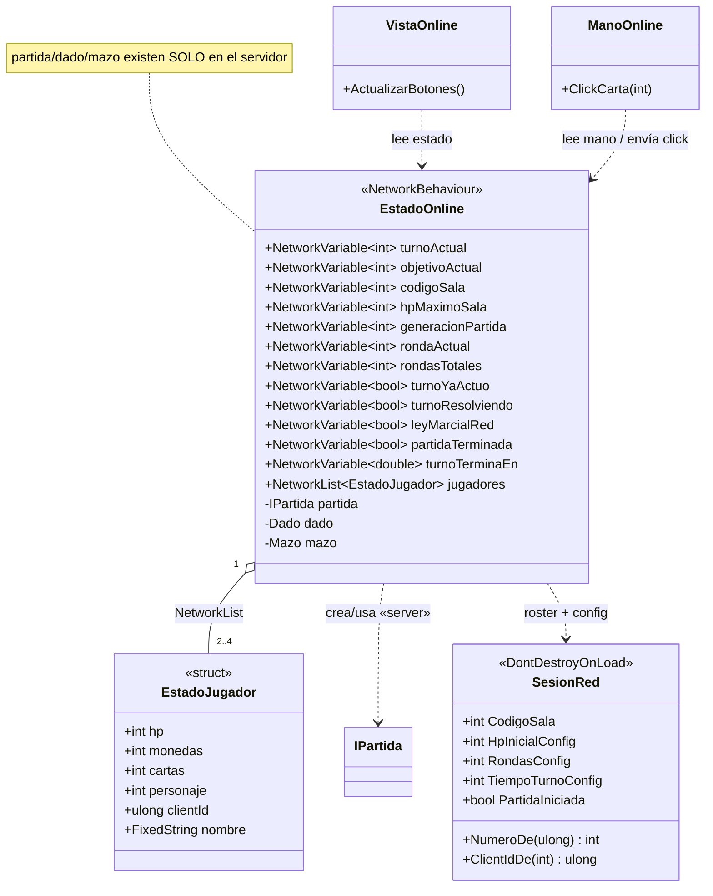
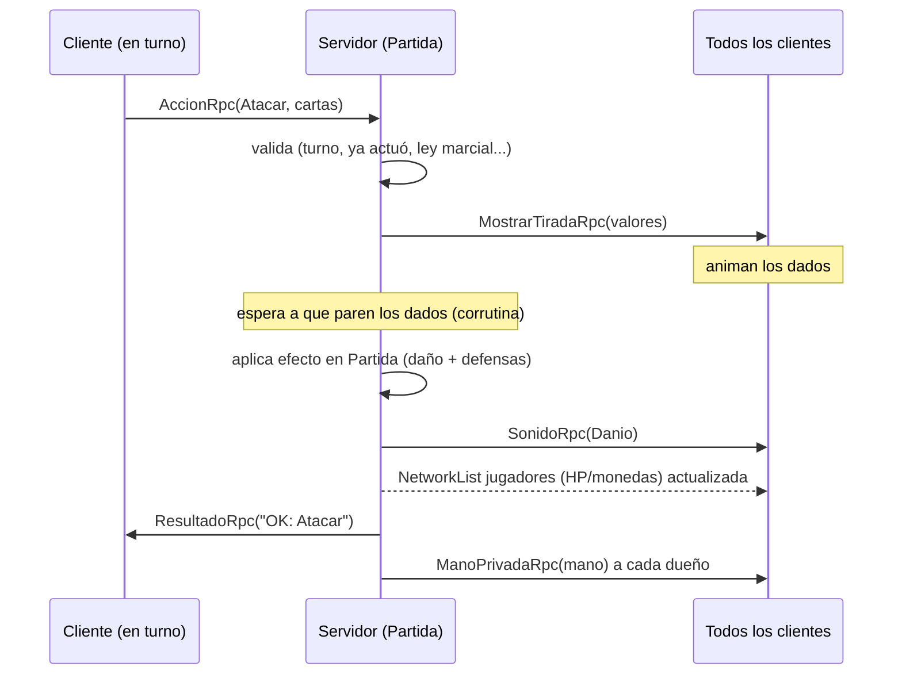

# 📐 Diagrama UML (Online / Red) — MONATAC

Diagrama de clases del proyecto, **dónde se usan los RPCs** y **qué datos se sincronizan** (lo que pide la
consigna del TFI). Los diagramas están en **Mermaid**: GitHub los renderiza solo. Complementa al UML de
clases del modo HotSeat ([`UML.md`](UML.md)) y al informe técnico ([`Informe-Tecnico.md`](Informe-Tecnico.md)).

> **Arquitectura en 3 capas** (regla de oro del proyecto): `/Data` y `/Rules` son **C# puro** (no conocen
> Unity ni la red); `/Visual` es todo lo de Unity. El online **reusa** `/Rules` tal cual en el servidor.

---

## 1) Capas y dependencias

**Por qué importa (defensa):** la lógica no depende del motor ni de la red → el servidor corre `Partida`
sin cambios y los clientes nunca calculan nada (servidor autoritativo).

---

## 2) Clases del dominio (`/Data` + `/Rules`)

**Patrones visibles:** *herencia + polimorfismo* (Carta y Accion), *Factory* (FabricaDeCartas), *DIP*
(todos dependen de `IPartida`, no de `Partida`).

---

## 3) Capa de red (`/Visual/Online`)

**Clave:** `EstadoOnline` tiene la `Partida` **solo en el servidor**; a los clientes les llega todo como
NetworkVariables + NetworkList (el "espejo"). Los *presenters* (`VistaOnline`, `ManoOnline`, …) solo
**leen** ese espejo y dibujan. `SesionRed` mantiene el roster `clientId → número` y, para la **reconexión**,
reconoce a un jugador que vuelve por un `playerId` estable (Connection Approval).

---

## 4) RPCs — dónde y para qué

Todos viven en **`EstadoOnline`**. Tres patrones según `SendTo`:

| RPC | SendTo | Dirección | Para qué |
|---|---|---|---|
| `SiguienteTurnoRpc` | Server | cliente → server | pasar turno |
| `AccionRpc` | Server | cliente → server | atacar / curarse / recolectar (con cartas) |
| `CambiarObjetivoRpc` | Server | cliente → server | rotar a quién apunta |
| `DescartarRpc` | Server | cliente → server | descartar una carta |
| `ComprarRpc` | Server | cliente → server | comprar una carta |
| `PedirMiManoRpc` | Server | cliente → server | pedir mi mano privada (también al reconectar) |
| `ReiniciarRpc` | Server | cliente → server | revancha |
| `ClienteListoRpc` | Server | cliente → server | avisar que cargó (pantalla de carga) |
| `MostrarTiradaRpc` | Everyone | server → todos | difundir la tirada + animar dados |
| `FinRpc` / `OcultarFinRpc` | Everyone | server → todos | mostrar / ocultar pantalla de fin |
| `SonidoRpc` | Everyone | server → todos | reproducir un SFX |
| `MostrarGrupalRpc` | Everyone | server → todos | animar la carta grupal |
| `TodosListosRpc` | Everyone | server → todos | ocultar la pantalla de carga |
| `ResultadoRpc` | SpecifiedInParams | server → **emisor** | resultado de la acción (OK / rechazado) |
| `ManoPrivadaRpc` | SpecifiedInParams | server → **dueño** | la mano privada de cada jugador |

### Secuencia de una acción (ejemplo: Atacar)

---

## 5) Datos sincronizados

**NetworkVariables** (las escribe **solo el server**, las leen todos):

| Variable | Tipo | Qué representa |
|---|---|---|
| `turnoActual` | int | de quién es el turno |
| `objetivoActual` | int | a quién apunta el ataque |
| `codigoSala` | int | código de la sala (ID visible) |
| `hpMaximoSala` | int | HP máximo (para llenar las barras) |
| `generacionPartida` | int | nº de partida (resetea la UI en la revancha) |
| `rondaActual` / `rondasTotales` | int | contador de rondas |
| `turnoYaActuo` | bool | el jugador en turno ya tiró/descartó |
| `turnoResolviendo` | bool | los dados están girando |
| `leyMarcialRed` | bool | ley marcial activa |
| `partidaTerminada` | bool | ya hay ganador |
| `turnoTerminaEn` | double | instante (ServerTime) en que vence el turno (tiempo límite) |

**NetworkList** `jugadores : NetworkList<EstadoJugador>` — por jugador: `hp, monedas, cartas (cantidad),
personaje, clientId, nombre`. (El **contenido** de la mano NO va acá: es privado.)

**Privado (ClientRpc dirigido):** la **mano** de cada jugador viaja solo a su dueño por `ManoPrivadaRpc`
(nombres de cartas), y el **resultado** de cada acción solo al emisor por `ResultadoRpc`.

**Por qué así (defensa):** lo público (HP, turno, objetivo…) va por NetworkVariables/NetworkList para que
todos vean lo mismo; lo privado (tu mano) va por RPC dirigido para no filtrarlo a los rivales. El contador
de turno sincroniza **un instante de fin** (no los segundos frame a frame): cada cliente calcula lo que
resta localmente con `ServerTime`.
